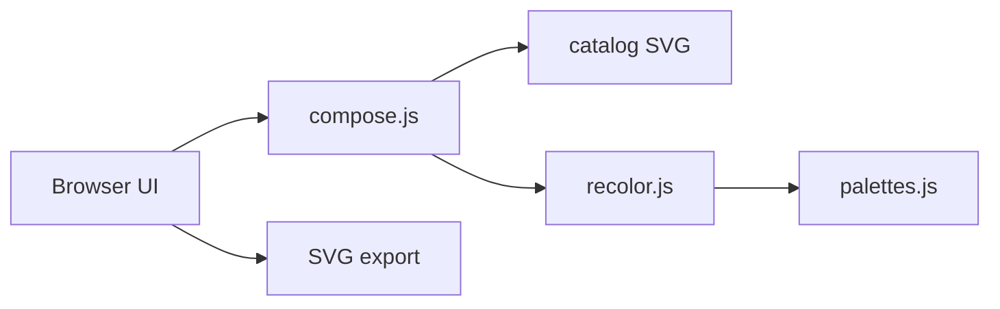

# Конструктор иллюстраций

Веб-сервис собирает композиции из готовых SVG-объектов. Новые объекты не генерируются. Без зависимостей и сборки: ES-модули + статический сервер на Node.

{{скриншот}}

## Возможности

- Метафора или заголовок → подбор из каталога (локально по тегам или с ключом API в браузере)
- Список компонентов через запятую → сборка с сохранением порядка
- Размеры L/S, главные и фоновые объекты, редактор (drag, rotate, undo, сетка)
- Палитры с ролями цвета и автоматическая перекраска
- Экспорт в редактируемый SVG; безопасный импорт своих SVG
- Повторяемый seed раскладки; «Перемешать» меняет seed

## Архитектура



## Стек

Node (static server) · ES modules · SVG · optional Claude/xAI from the browser

## Запуск

```bash
npm start   # http://localhost:5173
# или: make run
```

Docker: `docker build -t illustration-composer . && docker run --rm -p 5173:5173 illustration-composer`

Тесты: `make test` / `npm test`. Живой демо: https://blessed-bless.github.io/illustration-composer/

Видео: [docs/demo.mp4](docs/demo.mp4). Аудит по ТЗ: [docs/AUDIT.md](docs/AUDIT.md).

## Конфиг

| Переменная | Назначение |
| --- | --- |
| `PORT` | Порт статического сервера (по умолчанию 5173) |

Ключ LLM вводится в UI и остаётся в браузере — серверных секретов нет.

## Автор

Богдан Щербинин ([blessed-bless](https://github.com/blessed-bless))
